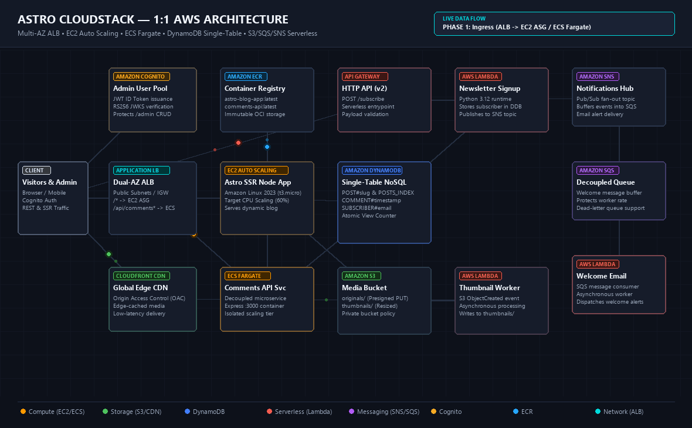

# 🚀 Astro CloudStack — Production Multi-Tier AWS Full-Stack Application

[](https://www.terraform.io/)
[](https://aws.amazon.com/)
[](https://astro.build/)
[](https://www.docker.com/)
[](https://nodejs.org/)
[](https://www.python.org/)
[](LICENSE)
[](http://astro-blog-alb-458388419.ap-southeast-2.elb.amazonaws.com/)

A **production-grade, multi-tier cloud application and publishing platform** built from the ground up on AWS.

It features containerized server-side rendering (SSR), decoupled microservices on serverless containers, high-performance single-table NoSQL modeling, an event-driven media processing pipeline, and automated Infrastructure as Code (IaC) via Terraform.

> 🌐 **Live Deployed Stack**:
> - **Live Blog Web App**: [http://astro-blog-alb-458388419.ap-southeast-2.elb.amazonaws.com](http://astro-blog-alb-458388419.ap-southeast-2.elb.amazonaws.com)
> - **Comments Microservice (ECS Fargate)**: `http://astro-blog-alb-458388419.ap-southeast-2.elb.amazonaws.com/api/comments`
> - **Media CloudFront CDN**: [https://d1ao4t7pgbfkt5.cloudfront.net](https://d1ao4t7pgbfkt5.cloudfront.net)
> - **Newsletter API Gateway**: `https://d6batvanv9.execute-api.ap-southeast-2.amazonaws.com/subscribe`

---

## 🎬 Architecture & Live Data Flow

<p align="center">
  
</p>

<p align="center">
  <em>Live 1:1 AWS architecture data flow: Multi-AZ ALB Layer 7 routing, EC2 ASG, ECS Fargate, DynamoDB Single-Table, and S3/SQS/SNS serverless event pipeline.</em>
</p>

---

## ⚡ 60-Second Quickstart

Deploy the entire full-stack application on your AWS account with a single command. The script checks dependencies (Docker/Podman, Terraform, AWS CLI), handles authentication, builds containers, provisions AWS infrastructure, and seeds initial data automatically.

### Windows (PowerShell)
```powershell
git clone https://github.com/hardikxk/astro-blog-aws-full-stack.git
cd astro-blog-aws-full-stack
.\setup.ps1
```

### Linux / macOS (Bash)
```bash
git clone https://github.com/hardikxk/astro-blog-aws-full-stack.git
cd astro-blog-aws-full-stack
chmod +x setup.sh deploy.sh manage.sh destroy.sh
./setup.sh
```

Once deployment completes, the script outputs your **Live ALB URL** and resources.

---

## 🏛️ System Architecture

```
                                 Internet / User Browser
                                            |
                                  [ CloudFront CDN ] <----+ (Global Cached Media)
                                            |             |
                             Application Load Balancer (ALB)
                                /                        \
                   Default Route (/*)                  /api/comments*
                           |                                     |
           EC2 Auto Scaling Group (ASG)               ECS Fargate Task
            (Astro SSR Node Container)             (Comments Microservice)
                  /             \                                |
                 /               ----------------+----------------
                |                                |
                v                                v
       Amazon DynamoDB (Single-Table: POST#id, COMMENT#id, SUBSCRIBER)
                ^
                |
  +-------------+---------------------+-------------------------------+
  |                                   |                               |
Amazon S3 Media Bucket             API Gateway (HTTP API)           Amazon Cognito
(originals/ & thumbnails/)              |                         (Admin User Pool)
  | (S3 Event Trigger)                  v                               |
  v                           Lambda: newsletter-signup            Admin Portal
Lambda: thumbnail-generator             |                           /admin
  |                                     v
  +--> thumbnails/                  Amazon SQS (Queue)
                                        |
                                        v
                              Lambda: send-welcome-email
                                        |
                                        v
                             Amazon SNS Topic (Email Alerts)
                                        ^
                                        |
                            CloudWatch Metric Alarms
                           (ALB 5XX & EC2 High CPU)
```

---

## 🌟 Key Features & Architectural Patterns

### 1. Hybrid Compute Architecture (EC2 ASG + ECS Fargate)
- **Astro SSR on EC2**: The core web app runs containerized inside Amazon Linux 2023 `t3.micro` instances managed by an **Auto Scaling Group** with **Target-Tracking CPU scaling (60%)**.
- **Decoupled Microservice on ECS Fargate**: Commenting & reactions run as an isolated Express microservice on serverless Fargate. High-volume commenting traffic cannot degrade the main blog reader experience.
- **Layer 7 Path Routing**: A single **Application Load Balancer (ALB)** routes `/api/comments*` to ECS Fargate and `/*` to EC2, eliminating cross-origin (CORS) complexity.

### 2. High-Performance Single-Table DynamoDB Design
A single NoSQL table (`astro-blog-table`) provides sub-10ms latency at any scale:
- `PK = POST#<slug>`, `SK = METADATA`: Full blog post record & markdown body.
- `PK = POSTS_INDEX`, `SK = POST#<slug>`: High-speed index for instant listings without expensive table scans.
- `PK = POST#<slug>`, `SK = COMMENT#<timestamp>`: Post comment threads in chronological order.
- `PK = SUBSCRIBER#<email>`, `SK = METADATA`: Newsletter subscribers.
- **Atomic View Counters**: Increments article views in place (`ADD views 1`) without race conditions.

### 3. Serverless Event-Driven Pipeline
- **S3 Presigned Direct Uploads**: Admins upload high-res images directly from their browser to S3 via presigned URLs, avoiding web server bandwidth bottlenecks.
- **S3 Event-Driven Lambda**: An `s3:ObjectCreated` trigger automatically invokes a Python 3.12 Lambda to process and route thumbnails into `thumbnails/` for fast CloudFront delivery.
- **CloudFront CDN with OAC**: Cached globally with Origin Access Control, keeping the S3 bucket private.
- **Decoupled Newsletter Pipeline**: API Gateway (`POST /subscribe`) invokes a signup Lambda, persists the subscriber, and emits an event to **Amazon SNS** -> buffered into **Amazon SQS** -> consumed by an asynchronous **welcome-email worker Lambda**.

### 4. Enterprise Identity & Administration
- **Amazon Cognito User Pool**: Protects the `/admin` portal with cryptographic JWT ID token verification (RS256) via JWKS.
- **Full CRUD Management**: Built-in visual dashboard for authoring, image embedding, listing, and deleting posts.

---

## 🧰 Unified Management CLI (`manage.ps1` / `manage.sh`)

This project includes a built-in management utility:

```powershell
# Open interactive management menu
.\manage.ps1

# Or run actions directly:
.\manage.ps1 dev          # Start local dev server (http://localhost:4321)
.\manage.ps1 build        # Validate local production build
.\manage.ps1 deploy       # Run automated Terraform & ECR deployment
.\manage.ps1 status       # Print live AWS URLs and health checks
.\manage.ps1 create-user  # Provision a new Cognito admin user
.\manage.ps1 seed         # Seed DynamoDB with sample articles
.\manage.ps1 logs         # Tail live ECS Comments API CloudWatch logs
.\manage.ps1 destroy      # Tear down all cloud resources to stop billing
```

*(On Linux / macOS, use `./manage.sh <action>`)*

---

## 🧪 Post-Deployment Verification Tour

1. **Visit Blog**: Navigate to [http://astro-blog-alb-458388419.ap-southeast-2.elb.amazonaws.com/](http://astro-blog-alb-458388419.ap-southeast-2.elb.amazonaws.com/) and verify dynamic server-side rendering and articles.
2. **Atomic Views**: Click into any post; observe the real-time view counter incrementing in DynamoDB.
3. **Comments Microservice**: Scroll down to the **Discussion** section and submit a comment. Notice the instant asynchronous post to the ECS Fargate container.
4. **Serverless Newsletter**: Enter an email in the subscription box; verify API Gateway -> Lambda -> DynamoDB -> SNS -> SQS pipeline execution.
5. **Admin Portal**:
   - Create your admin user:
     ```powershell
     .\manage.ps1 create-user
     ```
   - Log in at [http://astro-blog-alb-458388419.ap-southeast-2.elb.amazonaws.com/admin](http://astro-blog-alb-458388419.ap-southeast-2.elb.amazonaws.com/admin).
   - Publish a new article with an uploaded image.
   - Delete an article and verify instant removal from DynamoDB and the homepage.

---

## 💰 Cost Management & Teardown

- **Estimated Running Cost**: **~$1.60 / day** (~$45–$48 / month) when running 24/7 in Sydney (`ap-southeast-2`), primarily driven by the ALB ($19/mo), EC2 ($14/mo), and Fargate ($14/mo). DynamoDB, Lambda, S3, SQS, SNS, and Cognito run virtually free under the AWS Free Tier.
- **Clean One-Command Teardown**:
  To tear down all deployed cloud infrastructure and prevent ongoing billing, run:
  ```powershell
  .\destroy.ps1
  ```
  *(Or `./destroy.sh`)*. This completely deletes the ALB, EC2 ASG, ECS Fargate tasks, S3 bucket (with `force_destroy`), ECR repositories (with `force_delete`), and DynamoDB table. **All billing stops immediately.**
- **Re-deploy anytime**: Run `.\setup.ps1` to bring the entire stack back online in ~3 minutes.

---

## 📁 Repository Structure

```
├── .github/                  # CI/CD workflows (optional)
├── comments-api/             # Decoupled Express.js Comments microservice
│   ├── server.js
│   ├── Dockerfile
│   └── package.json
├── docs/                     # Visual architecture documentation
│   └── architecture_flow_animation.gif # Looping architecture animation
├── lambda-src/               # Serverless Python 3.12 functions
│   ├── thumbnail-generator/  # S3 event-driven thumbnail processor
│   ├── newsletter-signup/    # API Gateway signup handler
│   └── send-welcome-email/   # SQS worker consumer
├── scripts/                  # DynamoDB database seeding
│   └── seed.mjs
├── src/                      # Astro SSR Frontend & Admin Portal
│   ├── components/           # UI components (Comments, Newsletter, Hero)
│   ├── layouts/              # Base layouts & SEO metadata
│   ├── lib/                  # DynamoDB & Cognito auth client modules
│   └── pages/                # SSR routes & API endpoints (/api/posts, /admin)
├── terraform/                # 100% Declarative Infrastructure as Code (IaC)
│   ├── alb.tf                # Application Load Balancer & routing rules
│   ├── ec2.tf                # Launch template & Auto Scaling Group
│   ├── ecs.tf                # Fargate cluster, task def & service
│   ├── dynamodb.tf           # Single-table schema & on-demand billing
│   ├── s3.tf & cloudfront.tf # Media bucket & CloudFront CDN with OAC
│   ├── lambda.tf             # Serverless functions & IAM roles
│   ├── sns_sqs.tf            # Pub/Sub notifications & SQS buffer queue
│   ├── cognito.tf            # Admin identity & authentication
│   └── network.tf            # VPC, subnets, route tables, and IGW
├── deploy.ps1 / deploy.sh    # Core build, push & deploy automation
├── destroy.ps1 / destroy.sh  # Automated zero-waste teardown script
├── manage.ps1 / manage.sh    # Unified interactive CLI utility
├── setup.ps1 / setup.sh      # 1-click prerequisite check & bootstrap
└── Dockerfile                # Astro SSR production container
```

---

## 📄 License

This project is open-sourced under the [MIT License](LICENSE).
